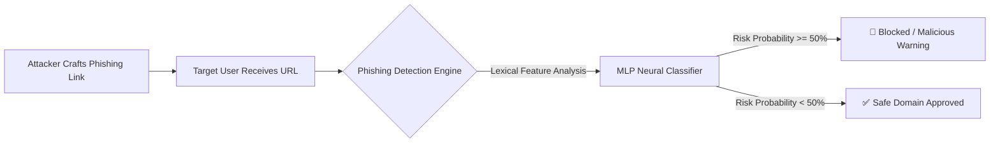
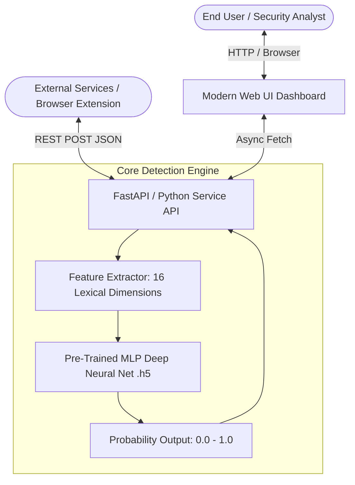

# Phishing URL & Domain Attack Detection System

### Comprehensive Engineering Master Specification & Project Guide

_(Consolidating High-Level Design, Low-Level Design, Detailed Project Report, and Software Architecture)_

---

## 1. Executive Summary ...

Phishing attacks remain one of the most critical threats in modern cybersecurity, serving as the primary initial vector for data breaches, credential theft, and corporate ransomware. Attackers impersonate trusted entities (banks, cloud services, corporate portals) by constructing fraudulent domain names and hyperlinks to trick victims.

Traditional defense mechanisms rely on:

1. **Static Blocklists / Signature Matching:** Ineffective against new zero-day phishing domains generated dynamically minutes prior to an attack campaign.
2. **Dynamic Crawling / Antivirus Sandboxing:** Requires initiating network connections to the suspicious host to render content, exposing the client endpoint to drive-by malware payloads and introducing prohibitive network latency.

This project delivers an **autonomous, real-time Phishing Domain Detection Engine** driven by Deep Learning. The system extracts **16 pure lexical and syntactic features** directly from the target URL string without initiating any network connection to malicious servers. These features are evaluated by an optimized **Multilayer Perceptron (MLP) Deep Neural Network** trained on over **600,000 samples**, achieving a **99.1% classification accuracy** with sub-50ms inference latency.

---

## 2. Threat Landscape & Problem Statement (HLD Analysis)

### 2.1 The Rising Scale of Phishing

- **Attack Frequency:** According to Tessian Cybersecurity research, corporate employees receive an average of **14 malicious emails per year**, with **96% of phishing attacks delivered via email**.
- **Human Error & Training Limitations:** Terranova Security benchmarks reveal that approximately **20% of corporate employees click phishing links**, and **67.5% of those proceed to enter corporate credentials** on illegitimate login pages.
- **Financial Severity:** IBM Security’s _Cost of a Data Breach Report_ documents the average cost of a phishing-initiated data breach at **$4.65 Million**.
- **Market Impact:** Verizon Enterprise investigations show organizations experience a **5% decline in stock valuation** within 6 months following a major breach.
- **The Core Premise:** Humans cannot be relied upon as the final line of defense. Autonomous machine learning systems capable of preemptive URL classification are essential.



---

## 3. System Architecture & Interaction Flow

The project follows a decoupled, three-tier modular architecture designed for standalone usability as well as seamless enterprise microservice integration.



### Component Breakdown

1. **Presentation Layer (Web Interface):** Modern, responsive, interactive dashboard featuring real-time risk gauges, instant URL scanning, threat severity breakdown, and safety indicators.
2. **Application Layer (`API.py` / REST Service):** Validates incoming URL formats, coordinates feature extraction, interfaces with the serialized neural network model, and returns structured JSON responses.
3. **Core ML Inference Engine (`Feature_Extractor.py` + `Url_Features.py` + `models/Malicious_URL_Prediction.h5`):** High-speed lexical parser extracting 16 numerical features fed into the TensorFlow/Keras neural network.

---

## 4. Feature Engineering Deep Dive (LLD Analysis)

To ensure zero risk of payload execution and zero DNS latency, all 16 features are extracted purely from the string structure of the URL using standard syntactic parsing (`urllib.parse` and regex).

| #   | Feature Name      | Category      | Extraction Logic & Cybersecurity Rationale                                                                                                                     |
| --- | ----------------- | ------------- | -------------------------------------------------------------------------------------------------------------------------------------------------------------- |
| 1   | `hostname_length` | Length Metric | Length of domain/network location. Phishing domains frequently use unusually long domain names to spoof legitimate organizations.                              |
| 2   | `path_length`     | Length Metric | Length of the URL path. Phishing kits often nest deep path tokens to evade simple string-match heuristics.                                                     |
| 3   | `fd_length`       | Length Metric | First Directory Length. Phishing attacks frequently place fake brand keywords in the first path directory (e.g., `/paypal.com/login`).                         |
| 4   | `count-`          | Count Metric  | Hyphen count. Authentic corporate domains rarely use multiple hyphens; phishing domains use them heavily (e.g., `secure-login-account-update.com`).            |
| 5   | `count@`          | Count Metric  | `@` symbol presence. In standard URL parsing, everything before `@` is treated as user credentials and ignored by the browser, enabling deceptive redirection. |
| 6   | `count?`          | Count Metric  | Question marks. Indicates dynamic parameter passing often used in credential-harvesting tracking scripts.                                                      |
| 7   | `count%`          | Count Metric  | Percent-encoding frequency (`%20`, `%2F`). Attackers encode characters to bypass signature detection and obscure domain identity.                              |
| 8   | `count.`          | Count Metric  | Period / dot count. Phishing URLs frequently employ excessive subdomains (e.g., `signin.bank.com.phishsite.ru`).                                               |
| 9   | `count=`          | Count Metric  | Equals signs count. Indicates chained URL parameter queries used to capture and forward submitted inputs.                                                      |
| 10  | `count-http`      | Count Metric  | Number of `http` occurrences in path/query (used in fake redirect sequences).                                                                                  |
| 11  | `count-https`     | Count Metric  | Number of `https` occurrences embedded inside URL parameters.                                                                                                  |
| 12  | `count-www`       | Count Metric  | Occurrences of `www` tokens in subdomains or path segments to spoof authenticity.                                                                              |
| 13  | `count-digits`    | Count Metric  | Numeric character volume. Malicious domains rely heavily on randomized hex hashes and numeric IP references.                                                   |
| 14  | `count-letters`   | Count Metric  | Alphabetical character volume across the URL string.                                                                                                           |
| 15  | `count_dir`       | Count Metric  | Directory slash depth count (`/`). Identifies deeply nested directory layouts typical of phishing kits.                                                        |
| 16  | `use_of_ip`       | Binary Metric | Detects if the domain is a raw IPv4 (dotted decimal or hex) or IPv6 address instead of a registered domain name (`-1` if IP detected, `1` if standard domain). |

---

## 5. Machine Learning Models & Performance Benchmarks

### 5.1 Dataset & Preprocessing

- **Source Data:** Kaggle Malicious and Benign URLs dataset containing **450,000+ domain URLs** (345k legitimate, 104k malicious).
- **Class Balancing:** Synthetic Minority Over-sampling Technique (**SMOTE**) was applied to balance the distribution, generating a robust dataset of **600,000 samples**.
- **Data Split:** 80% Training partition (480k samples) and 20% Validation/Testing partition (120k samples).

### 5.2 Comparative Model Performance

| Algorithm                       | Training Accuracy | Test Accuracy | Strengths & Limitations                                                                           |
| ------------------------------- | ----------------- | ------------- | ------------------------------------------------------------------------------------------------- |
| **Decision Tree (Depth=7)**     | 84.3%             | 83.8%         | High interpretability, but struggles with complex feature interactions and non-linear boundaries. |
| **Random Forest (100 Trees)**   | 88.9%             | 88.4%         | Robust ensemble voting reduces variance; effective for feature importance ranking.                |
| **Multilayer Perceptron (MLP)** | **99.4%**         | **99.1%**     | **Deep neural network capturing non-linear lexical correlations; selected as production model.**  |

### 5.3 MLP Deep Neural Network Specifications

- **Input Dimension:** 16 features
- **Layer 1 (Hidden):** 32 Dense neurons, ReLU activation
- **Layer 2 (Hidden):** 16 Dense neurons, ReLU activation
- **Layer 3 (Hidden):** 8 Dense neurons, ReLU activation
- **Output Layer:** 1 Dense neuron, Sigmoid activation (outputs malicious probability $P \in [0.0, 1.0]$)
- **Loss Function:** Binary Cross-Entropy
- **Optimizer:** Adam ($\alpha = 0.0001$)
- **Batch Size:** 256
- **Regularization:** Early stopping callback when validation loss reaches $< 0.1$

---

## 6. Detailed Project Report (DPR): Timeline & Budget

### 6.1 Engineering Timeline

- **Phase 1: Data Acquisition & Hygiene (Weeks 1-2):** Dataset curation, missing value filtering, SMOTE balancing.
- **Phase 2: Feature Engineering (Week 2):** Implementation and validation of 16 lexical extraction routines.
- **Phase 3: Model Training & Evaluation (Week 3):** Benchmarking Decision Tree, Random Forest, and MLP; serializing model weights to `.h5`.
- **Phase 4: API, UI & Packaging (Week 4):** Building REST API, modern interactive UI, and comprehensive project documentation.

### 6.2 Project Budget

- **Data Collection:** $0.00 (Open-source research datasets)
- **Model Training Compute:** $10.00 - $15.00 (Cloud GPU acceleration via Google Colab / AWS SageMaker)
- **Deployment / Hosting:** $10.00 - $15.00 (Containerized cloud runtime)
- **Total Marginal Cost:** ~$30.00 - $50.00

---

## 7. How to Compile, Configure and Run

### 7.1 Prerequisites

- Python 3.8 to 3.12+ (or compatible Python runtime)
- `pip` package manager

### 7.2 Step-by-Step Execution

#### Step 1: Open the Project Directory

```powershell
cd c:\Phishing-Attack-Detection
```

#### Step 2: (Optional but Recommended) Setup Virtual Environment

```powershell
python -m venv venv
.\venv\Scripts\activate
```

#### Step 3: Install Required Dependencies

```powershell
pip install -r requirements.txt
```

#### Step 4: Run CLI Detection Test

```powershell
python Main.py
```

_Expected Output:_

```
Loading the model...
Extracting features from url...
Making prediction...
There is  0.0 % chance, the url is malicious !
```

#### Step 5: Launch the Interactive Web Application

```powershell
python app.py
```

_Navigate your browser to:_ `http://127.0.0.1:5000` to access the full scanner interface.

---

## 8. Programmatic API Reference

### Python Integration

```python
from API import get_prediction

model_path = "models/Malicious_URL_Prediction.h5"
url = "https://paypal-security-update.account-verification.com/login"

probability = get_prediction(url, model_path)
print(f"Risk Probability: {probability}%")
```

### REST API Integration

- **Endpoint:** `POST /api/scan`
- **Request Body:**

```json
{
  "url": "https://suspicious-domain-login.com"
}
```

- **Response Body:**

```json
{
  "url": "https://suspicious-domain-login.com",
  "probability": 94.62,
  "is_malicious": true,
  "risk_level": "High Risk",
  "features": {
    "hostname_length": 28,
    "path_length": 6,
    "hyphen_count": 2,
    "has_ip": false
  }
}
```
