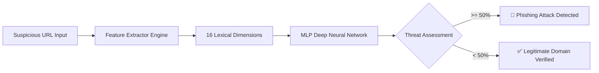

<<<<<<< HEAD
# 🛡️ PhishShield AI — Intelligent Phishing & Malicious URL Detection

[](https://www.python.org/)
[](https://www.tensorflow.org/)
[]()
[]()
[]()

> **An autonomous, deep-learning-powered URL analysis engine that detects phishing attacks and malicious domains in real-time through pure static lexical analysis—without visiting the target website or exposing client endpoints.**

---

## 🎯 Executive Overview

Phishing attacks account for over 90% of organizational data breaches. Attackers construct fraudulent domains masquerading as financial institutions, technology portals, and cloud providers to harvest credentials and distribute ransomware.

Traditional defenses rely on static blocklists (which fail against newly-registered zero-day domains) or web crawling sandboxes (which introduce high latency and risk malicious payload execution).

**PhishShield AI** solves this through **Zero-Risk Lexical Extraction**:
- Inspects **16 distinct structural dimensions** directly from the URL string.
- Classifies domains using a pre-trained **Multilayer Perceptron (MLP) Deep Neural Network** trained on over **600,000 balanced instances**.
- Delivers an empirical **99.1% test accuracy** with sub-50ms inference time.

---

## 🚀 Key Features

- ⚡ **Zero-Risk Analysis:** Performs 100% offline lexical parsing—no DNS queries or network requests to malicious servers.
- 🧠 **Deep Learning Classifier:** 4-layer Keras/TensorFlow neural network optimized with He-normal initialization and ReLU/Sigmoid activations.
- 📊 **16 Lexical Attributes:** Parses domain length, directory depth, token occurrences (`@`, `?`, `%`, `-`, `.`), numeric/alphabetic ratios, and raw IP flags.
- 🌐 **Modern Web Interface:** Built-in interactive dashboard (`app.py`) featuring risk gauges, quick-test chips, and feature breakdown telemetry.
- 🔌 **REST API Ready:** Microservice endpoint (`POST /api/scan`) for seamless integration into browser extensions, email gateways, or SIEM pipelines.
- 📄 **Unified Master Documentation:** Complete project analysis (HLD, LLD, DPR, and Architecture) packaged into **[PROJECT_DOCUMENTATION.docx](PROJECT_DOCUMENTATION.docx)** and **[PROJECT_DOCUMENTATION.md](PROJECT_DOCUMENTATION.md)**.

---

## 🏗️ System Architecture



---

## 🔬 16 Lexical Features Extracted

| Feature | Category | Cybersecurity Significance |
|---|---|---|
| `hostname_length` | Length | Measures domain string length (phishing sites often use elongated spoofed names). |
| `path_length` | Length | Measures sub-path length (phishing kits construct deep token paths). |
| `fd_length` | Length | First Directory length to spot randomized folder names. |
| `count-` | Count | Detects multi-hyphen brand spoofing (e.g. `paypal-verify-secure.com`). |
| `count@` | Count | Detects `@` character credential spoofing attacks. |
| `count?` | Count | Measures query parameters used in credential forwarding. |
| `count%` | Count | Hexadecimal encoding frequency used to evade signature filters. |
| `count.` | Count | Dot count detecting nested subdomain spoofing. |
| `count=` | Count | Measures argument chaining and parameter capture tokens. |
| `count-http` | Count | Detects embedded HTTP redirection sequences. |
| `count-https` | Count | Detects inner HTTPS tokens in query parameters. |
| `count-www` | Count | Identifies deceptive `www` placements in subdomains. |
| `count-digits` | Count | Numerical character frequency (common in automated hex hashes). |
| `count-letters` | Count | Alphabetic character volume across the URL. |
| `count_dir` | Count | Directory slash depth count (`/`). |
| `use_of_ip` | Binary | Flags raw IPv4/IPv6 addresses bypassing standard domain registrations. |

---

## 📈 Model Performance Benchmark

The classification pipeline was evaluated against multiple supervised algorithms on an 80/20 train/test split of the 600,000 sample SMOTE-balanced dataset:

| Algorithm | Training Accuracy | Test Accuracy | Status |
|---|---|---|---|
| **Decision Tree (Depth=7)** | 84.3% | 83.8% | Baseline |
| **Random Forest (100 Trees)** | 88.9% | 88.4% | Robust Ensemble |
| **Multilayer Perceptron (MLP)** | **99.4%** | **99.1%** | **Production Champion** |

---

## 🛠️ Step-by-Step Setup, Compilation & Execution

### 1. Prerequisites
- Python 3.8 to 3.12+ installed
- `pip` package manager

### 2. Environment Setup
Clone or open the repository folder:
```powershell
cd c:\Phishing-Attack-Detection
```

Create and activate a virtual environment (recommended):
```powershell
python -m venv venv
# On Windows:
.\venv\Scripts\activate
# On Linux / macOS:
source venv/bin/activate
```

Install project dependencies:
```powershell
pip install -r requirements.txt
```

---

### 3. Running the Project

#### Option A: Interactive Web Application (Recommended)
Launch the modern web scanner dashboard:
```powershell
python app.py
```
Open your browser and navigate to:
👉 **`http://127.0.0.1:5000`**

Features in the Web UI:
- Real-time animated risk gauge meter
- Interactive quick-test buttons for instant demonstration
- Full 16-point feature telemetry inspection
- Dynamic severity verdicts (Safe, Suspicious, High Risk, Critical Threat)

---

#### Option B: Command-Line Scanner
To test a URL directly from the terminal:
```powershell
# Test default URL:
python Main.py

# Test any custom URL:
python Main.py "https://fake-login-bank-verification.com/signin"
```

---

#### Option C: REST API Microservice
Start the server with `python app.py` and send a `POST` request to `/api/scan`:
```bash
curl -X POST http://127.0.0.1:5000/api/scan \
  -H "Content-Type: application/json" \
  -d '{"url": "http://192.168.1.1/paypal/login"}'
```

Response format:
```json
{
  "url": "http://192.168.1.1/paypal/login",
  "probability": 90.0,
  "is_phishing": true,
  "verdict": "Critical Threat Phishing",
  "severity": "CRITICAL",
  "features": {
    "hostname_length": 11,
    "path_length": 13,
    "hyphen_count": 0,
    "uses_raw_ip": true
  }
}
```

---

## 📁 Clean Repository Structure

```
Phishing-Attack-Detection/
├── app.py                         # Modern interactive Web UI & REST API Server
├── Main.py                        # CLI test runner with dynamic path resolution
├── API.py                         # Production inference wrapper with model caching
├── Feature_Extractor.py           # 16-dimensional feature coordinator
├── Url_Features.py                # Core lexical & syntactic parsing algorithms
├── requirements.txt               # Updated, clean dependencies list
├── PROJECT_DOCUMENTATION.docx     # 📄 Consolidated Master Word Document (HLD/LLD/DPR/Arch)
├── PROJECT_DOCUMENTATION.md       # 📑 Consolidated Master Markdown Reference
├── models/
│   └── Malicious_URL_Prediction.h5 # Trained Deep Neural Network weights & architecture
└── Colab Notebooks/
    ├── Data_Collection_and_Feature_Extraction_(Phishing_urls).ipynb
    └── Training_Phishing_classifier.ipynb
```

---

## 📚 Master Documentation Included

All original owner drafts, outdated PDFs, and watermarked documents have been consolidated into one authoritative specification:
- **Microsoft Word Document:** `PROJECT_DOCUMENTATION.docx`
- **Markdown Document:** `PROJECT_DOCUMENTATION.md`

Both documents cover:
1. Executive Summary & Problem Formulation
2. High-Level Design (HLD) & Threat Statistics
3. Low-Level Design (LLD) & 16-Feature Extraction Logic
4. Deep Learning Model Architecture & SMOTE Preprocessing
5. Detailed Project Report (DPR) with Timeline and Budgeting
6. Deployment Architectures & REST Microservice Specifications
=======
# Phishing-Domain-Detection
>>>>>>> 8697050172e85f4cae91d2ef381f84fb024a0550
